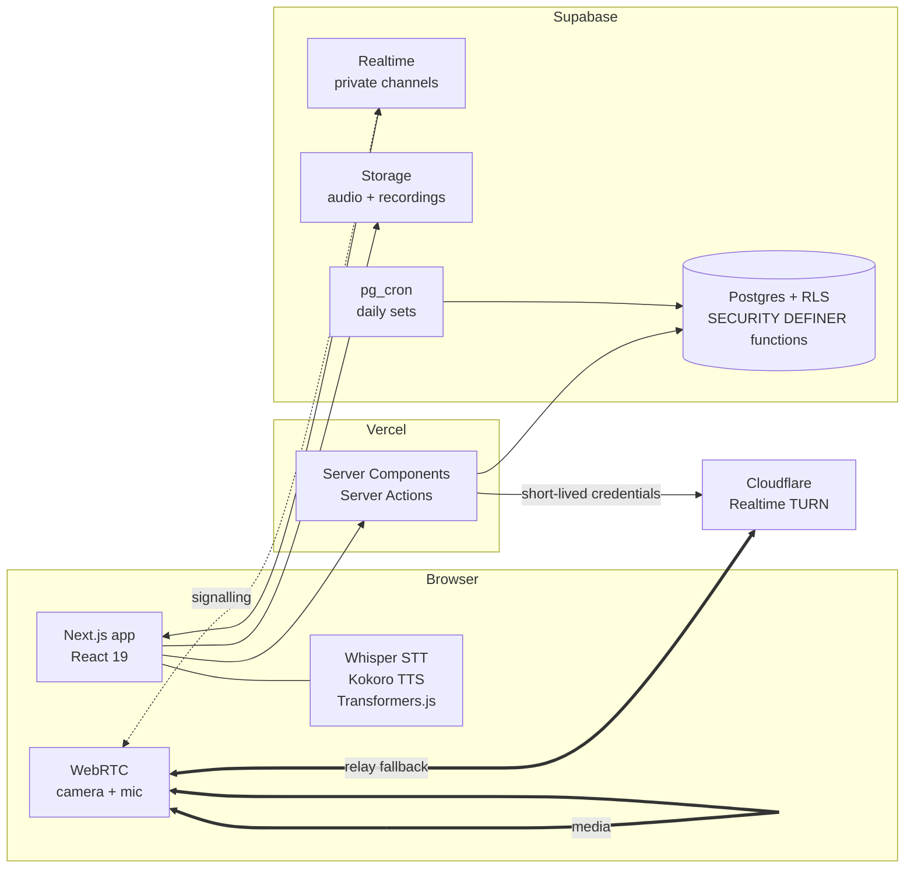

<div align="center">

# IELTS Squad

**Daily IELTS Academic practice for small study groups, with a live, examiner-timed Speaking room.**

[](https://ielts-squad.vercel.app)
[](https://nextjs.org)
[](https://react.dev)
[](https://supabase.com)
[](https://www.typescriptlang.org)

[**Open the app →**](https://ielts-squad.vercel.app)

</div>

---

IELTS Squad turns IELTS preparation into a shared daily habit. Every morning a group of two to ten
friends receives the same Listening, Reading and Writing set, completes it on their own schedule
before the daily deadline, and sees how everyone did. Speaking is practised the way it is examined:
face to face, in pairs, over an in-app video call where one member plays the examiner.

The interface is in Vietnamese; the test material and transcripts are in English.

## Highlights

| | |
| --- | --- |
| 📅 **One set a day, for everyone** | A fresh Listening, Reading and Writing set lands at midnight (Vietnam time). Writing alternates Task 1 and Task 2. Server-side timers, a daily deadline and streaks keep the group honest. |
| ✅ **Instant and AI-assisted marking** | Listening and Reading are marked inside the database the moment you submit. Writing and Speaking come with a ready-made grading prompt for Claude, and friends can add peer scores. |
| 📚 **302 ready-to-use tests** | 60 Listening, 60 Reading, 62 Writing and 120 full Speaking tests, original material written to the real exam format. Group owners can add more through a strictly validated import. |
| 🎙️ **A Speaking room that feels like the exam** | Camera and microphone on as you walk in. The examiner reads each question, then starts the answer clock; the Part 2 cue card appears on the candidate's screen only when the examiner hands it over. |
| ⏱️ **Pacing built in** | Per-question answer clocks (about 25 s in Part 1, 50 s in Part 3), the 1-minute preparation and 2-minute long turn, and live part and whole-test clocks against the real 11 to 14 minutes. |
| 📝 **Transcripts and recordings** | The candidate's answers are recorded, split by question and transcribed on device, with how long each answer ran. A full session can be saved as a video showing both cameras, the question and the clock. |
| 🌐 **Calls that connect from anywhere** | Peer-to-peer WebRTC, with an automatic fallback to a Cloudflare relay when home routers, VPNs or mobile networks block a direct connection. |

## A Speaking session

```
 Examiner                                   Candidate
 ────────                                   ─────────
 Reads the Part 1 question  ───────────▶    Listens
 Presses "Start answer clock" ──────────▶   Answer clock appears (0:00 / ~25 s)
 Reads the Part 2 introduction              Sees nothing yet
 Presses "Hand over cue card" ──────────▶   Cue card + 1:00 preparation countdown
 Presses "Start 2 minutes"  ────────────▶   2:00 long-turn countdown
 Works through Part 3, ends the test        Recording is transcribed and saved
```

Both screens show the time spent on the current part (4–5, 3–4 and 4–5 minutes) and on the whole
test, turning red when a part runs long, and the candidate sees the standard timing of every part.
The Space bar drives the examiner's main button, so they never have to look away from their partner.

Roles swap the moment a test ends: the candidate's device transcribes and saves in the background
while they examine their partner. Each person's volume can be turned down, muted or boosted up to 200%
on your own screen.

The saved transcript reads like an examiner's record:

```
Test length: 13:05

PART 1
Examiner: Do you work or study?
Candidate (0:24): I'm a second-year student at ...

PART 2
Cue card: Describe a person who has an unusual job. ...
Candidate (long turn, 1:52): The person I'd like to talk about ...
```

## Under the hood



| Layer | Technology |
| --- | --- |
| Application | Next.js 16 (App Router, Cache Components, Server Actions), React 19, TypeScript |
| Data and auth | Supabase Postgres with row-level security, Auth, Storage, Realtime, pg_cron |
| Interface | Tailwind CSS 4, shadcn/ui, Radix |
| Speech | Whisper (speech to text) and Kokoro (Listening narration) running in the browser via Transformers.js |
| Video | WebRTC mesh with perfect negotiation, Supabase Realtime signalling, Cloudflare Realtime TURN |
| Hosting | Vercel |

### Design decisions

- **No service-role key anywhere.** Every privileged action, from dealing the daily set to marking,
  streaks and Speaking turns, is a Postgres `SECURITY DEFINER` function that checks its caller. The
  app runs on the publishable key alone.
- **Answers never reach the browser early.** Answer keys and Listening transcripts live in a table
  with no read policy; marking happens in the database, and reviews open only after submission.
- **The server owns the clock.** Attempt deadlines are computed from the server's start time and the
  day's closing time, so a slow or paused device cannot buy extra minutes.
- **Speech runs on the device.** Narration and transcription happen in the browser, so audio never
  leaves the group's own storage and there is no per-minute AI bill.
- **Relay credentials stay on the server.** The browser only ever receives short-lived TURN
  credentials minted per session; the Cloudflare key never ships to the client.
- **Calls heal themselves.** Dropped or stalled connections restart ICE automatically, with one side
  leading so that two retries never cancel each other out. Without a relay, the room checks whether
  the local network blocks direct calls and says so.

## Repository layout

```
src/app/                 Routes: daily board, attempts, test bank, Speaking room
src/components/room/     Video call, session recorder, examiner sheet
src/lib/speaking-room/   Exam script, timing, transcripts, relay configuration
src/lib/tests/           Test import schema and grading prompts
content/bank/            Source of the 302 pre-written tests
supabase/migrations/     Schema, RLS policies, Postgres functions, schedules
scripts/                 Test bank tooling and relay setup
```

<details>
<summary><strong>Running it yourself</strong></summary>

Requirements: Node.js 22 and a Supabase project (or Docker for a local Supabase stack).

```bash
npm install
cp .env.example .env.local      # Supabase URL and publishable key
npx supabase db push            # apply supabase/migrations
npm run dev
```

| Variable | Purpose |
| --- | --- |
| `NEXT_PUBLIC_SUPABASE_URL`, `NEXT_PUBLIC_SUPABASE_PUBLISHABLE_KEY` | Supabase project |
| `CLOUDFLARE_TURN_KEY_ID`, `CLOUDFLARE_TURN_API_TOKEN` | Relay for video calls across restrictive networks (`npm run turn:setup` stores them on Vercel) |
| `TURN_URLS`, `TURN_USERNAME`, `TURN_CREDENTIAL` | Any other TURN provider instead of Cloudflare |

`npm test`, `npm run typecheck` and `npm run lint` check the code; `npm run bank:check` validates every
test in the bank. Deploy with `npx vercel deploy --prod`.

</details>

## Acknowledgements

[Whisper](https://github.com/openai/whisper) and [Kokoro](https://huggingface.co/hexgrad/Kokoro-82M)
through [Transformers.js](https://github.com/huggingface/transformers.js), [shadcn/ui](https://ui.shadcn.com),
[Supabase](https://supabase.com), [Vercel](https://vercel.com) and
[Cloudflare Realtime](https://developers.cloudflare.com/realtime/). IELTS is a registered trademark of
the British Council, IDP: IELTS Australia and Cambridge University Press & Assessment; this project is
not affiliated with or endorsed by them, and its test material is original.

## License

No license is granted. The source is public for reference; all rights are reserved.
